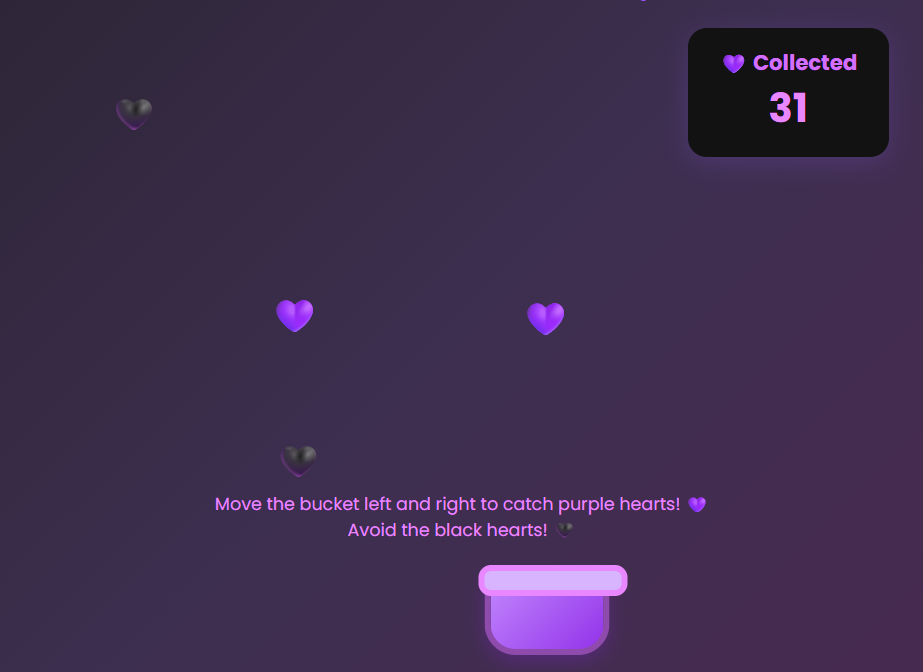
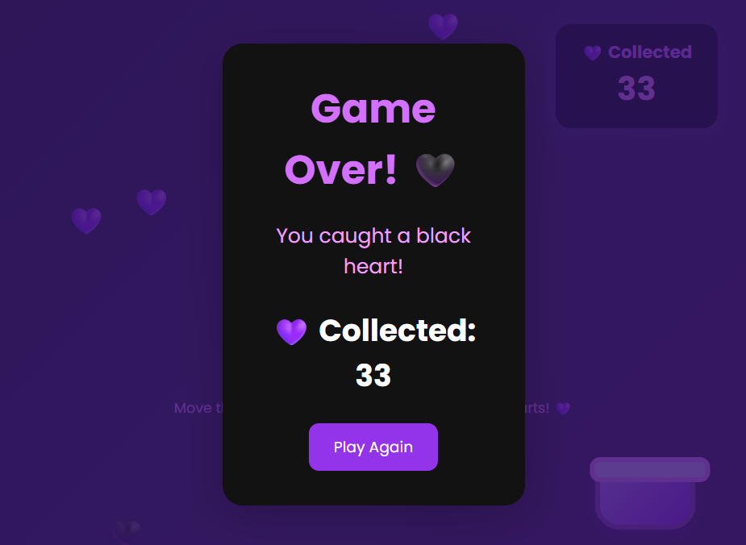

# Purple Heart Catcher Game

Purple Heart Catcher is a simple browser-based game developed using HTML, CSS, and JavaScript. The game involves catching falling purple hearts using a movable bucket while avoiding black hearts.

The objective is to collect as many purple hearts as possible without catching a black heart. Each successful catch increases the score, while catching a black heart immediately ends the game.

## Game Overview

The game features two types of falling hearts, each with a different purpose:

- **Purple Heart (💜):** The main collectible item. Catching a purple heart in the bucket increases the collected score by one.
- **Black Heart (🖤):** An obstacle that must be avoided. If a black heart enters the bucket, the game ends immediately.

A bucket is positioned at the bottom of the screen and can be moved horizontally from left to right to catch the falling purple hearts and avoid the black ones.

## Screenshots

### Gameplay


### Game Over


## Features

- **Random Heart Generation:** Purple and black hearts appear randomly and fall from the top of the screen.
- **Horizontal Bucket Movement:** Move the bucket left and right using mouse or touch controls.
- **Score Tracking:** Every purple heart successfully collected increases the score by one.
- **Collision Detection:** Detects when a falling heart enters the bucket.
- **Game Over Mechanism:** Catching a black heart immediately ends the game.
- **Final Score Display:** Shows the total number of purple hearts collected before the game ends.
- **Restart Functionality:** Allows players to restart the game using the Play Again button.

## How to Play

1. Open the game in a web browser.
2. Control the bucket by moving your mouse or finger horizontally across the screen.
3. Catch the falling purple hearts (💜) using the bucket.
4. Each purple heart caught adds one point to your score.
5. Avoid the falling black hearts (🖤) at all costs.
6. If a black heart enters the bucket, the game ends.
7. Check your final score and click the **Play Again** button to start a new round.

## Technologies Used

- **HTML5:** Used to structure the game elements.
- **CSS3:** Used for styling, layout, background design, and animations.
- **JavaScript:** Used to implement heart generation, falling movement, bucket controls, collision detection, score updates, and game state management.

## Project Structure

```text
PurpleHeart-Catcher-Game/
│
├── images/
│   ├── preview-game.png
│   └── preview-gameover.png
│
├── game.html
│
└── README.md
```

## How to Run Locally

1. Clone the repository:

   ```bash
   git clone https://github.com/shruti18sk/PurpleHeart-Catcher-Game.git
   ```

2. Navigate to the project directory:

   ```bash
   cd PurpleHeart-Catcher-Game
   ```

3. Open `game.html` in your browser.

4. Start playing and try to collect as many purple hearts as possible!

## Repository

[Purple Heart Catcher Game](https://github.com/shruti18sk/PurpleHeart-Catcher-Game)

---

Developed using HTML, CSS, and JavaScript.
